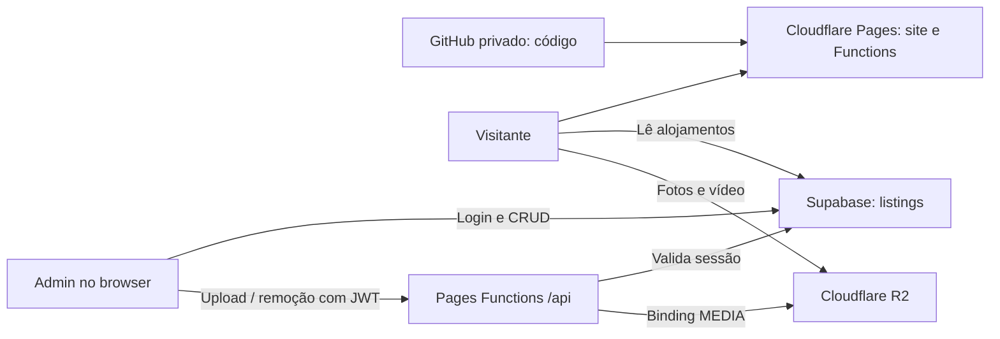

# Arquitetura e mapa do projeto

Levantamento de 28 de outubro de 2026. Os acessos administrativos pendentes estão no relatório de estado.

## Serviços e fluxo

| Componente | Identificação atual | Evidência |
| --- | --- | --- |
| Código | `github.com/Isacsa/letheslegacy`, privado, branch principal `main` | Git e API GitHub |
| Site | `https://letheslegacy.com` e `https://www.letheslegacy.com` | HTTP 200 |
| Alojamento | Cloudflare Pages, projeto `letheslegacy` | Check GitHub de deploy e `letheslegacy.pages.dev` acessível |
| Base de dados e login | `https://sdodixuwfsevnoidkldv.supabase.co` | `config.js`, leitura pública e Auth settings |
| Ficheiros dos alojamentos | Cloudflare R2; bucket esperado `letheslegacy-media` | Código e guia anterior; nome no painel por reconfirmar |
| Domínio dos ficheiros | `https://media.letheslegacy.com` | Dados atuais e HTTP 200 em ficheiros de exemplo |
| Endpoint antigo do R2 | `https://pub-aa72ada04c444be4ba353768bbc5513b.r2.dev` | HTML atual e HTTP 200 |

A cache local associa o Cloudflare à conta de Isac, ID `bf3e7b33dc06118807a98c71d93c8e02`. O check de publicação aponta para [o projeto Pages nessa conta](https://dash.cloudflare.com/?to=/bf3e7b33dc06118807a98c71d93c8e02/pages/view/letheslegacy). A sessão local Cloudflare expirou, pelo que não foi possível ler a configuração administrativa atual. O fornecedor de registo do domínio e a faturação não foram confirmados; DNS passar pelo Cloudflare não prova que o registo tenha sido comprado lá.

## Site público

`index.html` contém a apresentação da marca: vídeo inicial, cartões para casas/apartamentos/quartos, gestão de AL, experiências, sobre, contactos e rodapé institucional. A secção de destinos existe no código, com o link de navegação comentado.

`alojamentos.html` contém os filtros e o espaço da grelha. `alojamentos-data.js` lê `public.listings`, ordena por `position` e `created_at`, e cria os cartões e a galeria/modal. Há links partilháveis através de `?alojamento=<slug>`; continuam a ser aceites URLs antigos com UUID. Se existirem títulos iguais, o ID distingue o slug.

As reservas são contactos por WhatsApp (`+351 927 155 336`). Não existe motor de reservas, pagamento ou gestão de disponibilidade neste repositório. O email público é `letheslegacy@gmail.com`. Há ligações ao Google Maps e ao portal institucional `https://prr.brilean.cloud`.

O aspeto usa creme, castanho escuro e dourado, com Cormorant Garamond nos títulos e Montserrat no texto. `style.css` é partilhado; `transitions.js` faz a transição entre páginas, respeitando a preferência de movimento reduzido.

## Dados e administração

O painel em `/admin.html` usa Supabase Auth com email/password. Não contém uma password fixa no código, nem um fluxo próprio de criação de conta ou recuperação de password. A sessão é gerida pelo cliente Supabase no browser.

Permite criar, editar, ordenar e eliminar alojamentos; definir capa, fotografias, vídeos, preço, capacidade, morada, descrição, etiqueta e tipologias; e ver uma pré-visualização durante a edição. A etiqueta alimenta `badge` e `meta`. A capa é guardada em `cover`; `preview` recebe as primeiras quatro fotos da galeria.

Tabela `public.listings`:

| Grupo | Campos |
| --- | --- |
| Identidade e ordem | `id`, `position`, `type`, `created_at`, `updated_at` |
| Texto | `badge`, `title`, `meta`, `feature`, `capacity`, `address`, `description`, `price` |
| Media | `cover`, `preview[]`, `gallery[]`, `videos[]` |
| Tipologias | `units` como JSON de `{name, details}` |

Tipos aceites: `casas`, `apartamentos`, `quartos`. Preço ou capacidade vazios aparecem como “Sob consulta”. O trigger SQL atualiza `updated_at`.

O catálogo verificado tem 13 alojamentos (5 casas, 6 apartamentos, 2 conjuntos de quartos), 570 fotografias únicas referidas nas galerias e zero vídeos associados a alojamentos. O vídeo da landing é independente desses dados.

## Fotografias e vídeos

| Local | Conteúdo | Vai no clone Git? |
| --- | --- | --- |
| R2 `alojamentos-web/...` | Fotos publicadas e novos uploads dos alojamentos | Não |
| R2 `uploads/...` | Logótipo, vídeo/banner e imagens institucionais da landing | Não |
| `assets/images/categories/` | Imagens dos 3 cartões, em duas resoluções | Sim |
| `assets/images/footer-rep-portuguesa.jpeg` | Faixa institucional | Sim |
| `favicon.png`, `letheslogo.png` | Ficheiros locais da marca | Sim |
| `alojamentos/` neste Mac | 329 JPG e arquivos ZIP originais, cerca de 729 MB | Não, ignorado |
| `alojamentos-web/` neste Mac | 329 WebP de uma versão anterior, cerca de 44 MB | Não, ignorado |
| `uploads/` neste Mac | 18 ficheiros da marca/banner, cerca de 53 MB | Não, ignorado |
| `images.unsplash.com` | Imagens remotas de destinos e fundo do catálogo | Não, dependência externa |

Os tamanhos são aproximados, medidos neste computador. As pastas locais não cobrem os uploads posteriores: não substituem um backup dos conteúdos atuais do R2.

Objetos da landing atualmente referidos no HTML: `uploads/logo.webp`, `uploads/banner1-poster.webp`, `uploads/banner1.mp4`, `uploads/banner1.webm`, `uploads/landingpage1.webp` e `uploads/landingpage2.webp`. Ainda usam o endpoint antigo `r2.dev` diretamente. A normalização de URLs em `alojamentos-data.js` e `admin.js` não atua sobre esses atributos do HTML.

Novos uploads usam `alojamentos-web/<slug>/<uuid>.<ext>` e vídeos `alojamentos-web/<slug>/videos/<uuid>.<ext>`. O admin comprime fotos para WebP, até 1800 px no maior lado e qualidade 0,82; usa JPEG se o browser não codificar WebP e carrega um conversor para HEIC/HEIF. O servidor aceita JPEG/PNG/WebP/AVIF e MP4/WebM/QuickTime, até 120 MiB por ficheiro. Limites do plano Cloudflare podem reduzir o máximo efetivo.

## Functions e permissões

- `POST /api/upload`: valida JWT no Supabase, compara email com `ADMIN_EMAILS` quando a variável está definida, valida tipo/tamanho e grava em `env.MEDIA`.
- `POST /api/delete`: faz as mesmas verificações e elimina chaves sob `alojamentos-web/`; não elimina `uploads/`.
- Variáveis esperadas: `SUPABASE_URL`, `SUPABASE_ANON_KEY`, `R2_PUBLIC_BASE`, `ADMIN_EMAILS`; binding R2 `MEDIA`.
- `ADMIN_EMAILS` vazio deixa passar qualquer sessão Supabase válida nas Functions. A lista deve estar preenchida e coerente com a lista de admins da base de dados.
- O frontend usa a chave `anon` pública. A autorização de escrita depende de RLS e da sessão, não de esconder essa chave.
- `schema.sql` descreve o esquema inicial com escrita para utilizadores autenticados. `hardening.sql` substitui essas políticas por verificação de `private.admins` através de `public.is_admin()`. A aplicação efetiva dessas políticas precisa de confirmação administrativa.
- A limpeza de media após guardar/eliminar é best-effort. Um upload seguido de cancelamento pode deixar objetos sem referências. Não eliminar automaticamente objetos apenas por estarem ausentes de um manifesto.

## Ficheiros históricos

`scripts/migrate.mjs` era a migração inicial de um array fixo para o Supabase. O array atual está vazio; o dry run exporta zero linhas. Não é backup nem ferramenta de instalação no Windows.

`upload-r2.sh` existe só neste Mac, está ignorado pelo Git e tem um caminho absoluto de Isac. Serviu para o upload inicial de WebP; não é necessário para o admin ou para publicar o código.

`supabase/media-domain.sql` migra referências antigas de media na base de dados. O catálogo público atual já aponta para o domínio próprio; não voltar a executá-lo como rotina de transferência.

## Dependências externas

O browser carrega Supabase JS v2 pelo jsDelivr, fontes pelo Google Fonts e, quando necessário, `heic2any` v0.0.4 pelo jsDelivr. Parte das imagens vem do Unsplash. Não há lockfile, dependências npm da aplicação ou pipeline de testes/Actions no repositório atual.

`_headers` pede revalidação dos ficheiros mais alterados e `noindex` para admin/API. Os HTML também usam parâmetros `?v=...` para cache. O Cloudflare transforma os emails no HTML publicado; essa diferença face ao ficheiro local foi verificada.
